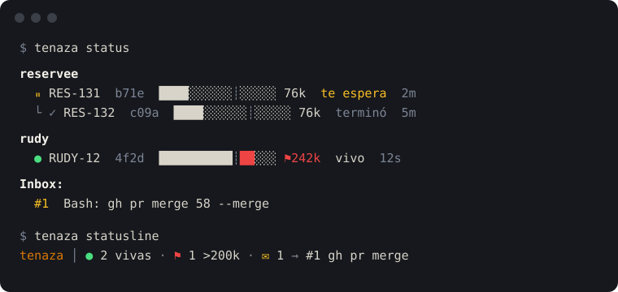

<p align="center">
  <picture>
    <source media="(prefers-color-scheme: dark)" srcset="assets/tenaza-dark.svg">
    
  </picture>
</p>

<h1 align="center">Tenaza</h1>

<p align="center">
  <strong>Hold your coding agents with tongs.</strong><br>
  See every session, keep the dangerous moves for yourself, and know when a context is running hot.
</p>

---

A *tenaza* is the blacksmith's tongs: the tool that holds hot metal so your hands don't have
to. Tenaza does that for coding agents. It hooks into Claude Code and:

- **Watches** every session and subagent, grouped by project, with a live context bar.
- **Holds back** the actions you reserve for yourself, like `gh pr merge` or a production write.
  The agent is told to stop and tell you, and the action waits in your **Inbox**.
- **Taps you on the shoulder** with a macOS notification when something waits for you, or when
  a session crosses its context threshold.

It never launches work and never runs a command on its own. Your agents do the work, and Tenaza
keeps the parts you reserved for your own hands.

<p align="center">
  
</p>

## Install

Requires macOS and [Claude Code](https://code.claude.com).

```bash
brew install matiinchauspe/tap/tenaza
tenaza init
```

Then, inside Claude Code, add the plugin that wires up the hooks:

```
/plugin marketplace add matiinchauspe/tenaza
/plugin install tenaza@tenaza
```

That's it. Every session from now on, main or subagent, is observed.

`tenaza init` does two things, and running it again changes nothing:

1. Writes a starter Policy to `~/.tenaza/config/policy.toml`, but never over an existing one.
2. Points Claude Code's statusline at Tenaza, but only if you don't have one yet. If you do,
   your settings are left untouched and it prints a line for you to add to your own script.

## A day with Tenaza

An agent tries to merge a PR:

```
gh pr merge 58 --merge
```

Claude Code's hook asks Tenaza first. The Policy reserves `gh pr merge` for you, so the call is
denied, and the agent reads:

> Reserved for the human, inbox #1. Do not retry or work around it. Tell the user, and continue.

A notification appears (🟡 *Tenaza · te espera · inbox #1*), and the item waits:

```bash
tenaza status         # the session tree and the Inbox
tenaza run 1          # run the stored command yourself, now; closes the item on success
tenaza done 1         # or: you ran it by hand
tenaza dismiss 1      # or: it no longer applies
```

## Commands

| Command | What it does |
| --- | --- |
| `tenaza init` | Prepare this machine: a starter Policy and the statusline. |
| `tenaza status` | Sessions as a tree per project, with context bars, then the Inbox. |
| `tenaza statusline` | One terse line for Claude Code's statusline. |
| `tenaza run <id>` | Run an Inbox item's command at your request. Closes on exit 0. |
| `tenaza done <id>` | Close an item you ran yourself. |
| `tenaza dismiss <id>` | Close an item that no longer applies. |
| `tenaza label key=value …` | Let an agent label its own session (e.g. `ticket=RES-131 project=reservee`). |
| `tenaza hook claude` | The entry point Claude Code's hooks call. You never run it by hand. |

Tenaza only ever executes a stored command through `tenaza run`, and closing an item twice is
harmless.

## The Policy

`~/.tenaza/config/policy.toml` is a list of Rules. Each matches text in a shell command, and the
first match wins:

```toml
[[rule]]
match = "gh pr merge"
effect = "human"   # deny it, and put it in your Inbox

[[rule]]
match = "git push --force"
effect = "flag"    # let it run, but record it

[flag]
threshold_tokens = 200000   # when a session's context is flagged
```

The starter Policy reserves `gh pr merge`, `git worktree remove` and a few production writes.
**Review it before you trust it:** the production-write rules are a best guess at how you type
those commands, and each one says so in a comment.

A Policy is a guardrail against honest mistakes, not a security boundary. An agent that words a
command differently walks right past a Rule.

## Reading the screen

| | |
| --- | --- |
| `⏸` *te espera* | Something in this session waits for you in the Inbox. |
| `●` *vivo* | Working. It reads *sin señal* if it has gone quiet for 15 minutes. |
| `✓` *terminó* / `○` *cerró* | A subagent finished, or a session closed. |
| `████░░┊░░` | Context used, 20k tokens per cell. `┊` marks your threshold, and cells past it turn red. |
| `⚑242k` | The session crossed the threshold. Tenaza only shows it, never stops it. |

A parent session shows the most urgent state among its subagents, so a waiting subagent is never
hidden. The statusline folds all of this into one line:

```
tenaza │ ● 2 vivas · ⚑ 1 >200k · ✉ 1 → #1 gh pr merge
```

## Labels

An agent can name the work it is doing by running `tenaza label ticket=RES-131 project=reservee`.
The hook catches the command and labels the session the call really came from, even inside a
subagent. The `ticket` label replaces the role on the session's row, and `project` decides the
group. Without a `project` label, sessions group by their git repository.

[Yunque](https://github.com/matiinchauspe/yunque), the agent harness Tenaza was built alongside,
announces these labels for you.

## Notifications

- 🟡 when an action lands in your Inbox.
- 🔴 the first time a session crosses the context threshold.

Nothing else notifies: no edits, no sessions ending, no resolutions. Several matches within two
seconds play a single sound. Notifications are sent with `osascript`, so there is nothing extra
to install, but macOS may ask for permission the first time. A failed notification never changes
whether an action is allowed.

## How it works

```
Claude Code hook ──► tenaza hook claude ──► ~/.tenaza/state/sessions/<session>.jsonl
                                                        │
                       tenaza status / statusline ◄─────┘   (state is derived on read)
```

There is no daemon. Each hook runs a short command that appends Events to one log per session,
and every view is derived from those logs when you ask for it. An adapter translates each agent
runtime's hooks into Tenaza's Events and declares what it can do (`observe`, `block`, `measure`).
The core degrades by that declaration, never by the runtime's name. The decisions behind this
shape live in [`docs/adr/`](docs/adr/).

| Setting | Default | Purpose |
| --- | --- | --- |
| `TENAZA_HOME` | `~/.tenaza` | Policy and session state. |
| `TENAZA_CLAUDE_SETTINGS` | `~/.claude/settings.json` | The settings file `tenaza init` edits. |

## Limits in v1

- **Claude Code only.** The core is runtime-free; other adapters can come later.
- **MCP Rules match the call, never its content.** An `mcp` Rule matches a tool name and
  conditions on its arguments (`unless` / `when`); the SQL text or other argument content
  itself is never inspected.
- **Subagent attribution is partial.** A subagent's blocked action and tool-call count are
  recorded under its parent session.
- **macOS notifications cannot be replaced.** Each one is a new banner.
- **Release binaries are unsigned.** Installing through Homebrew avoids the Gatekeeper prompt.

## Uninstall

```bash
brew uninstall tenaza
rm -rf ~/.tenaza
```

Then, inside Claude Code: `/plugin uninstall tenaza@tenaza`. Claude Code keeps working as before,
statusline included: the line `tenaza init` wrote prints nothing once `tenaza` is gone.

## Develop

```bash
bun install
bun test             # black-box tests against a temporary TENAZA_HOME; never a real notification
bun run typecheck
bun run build        # a single binary at dist/tenaza
```

Releases are built by CI on every `v*` tag, for macOS arm64 and x64.

## License

[MIT](LICENSE)
