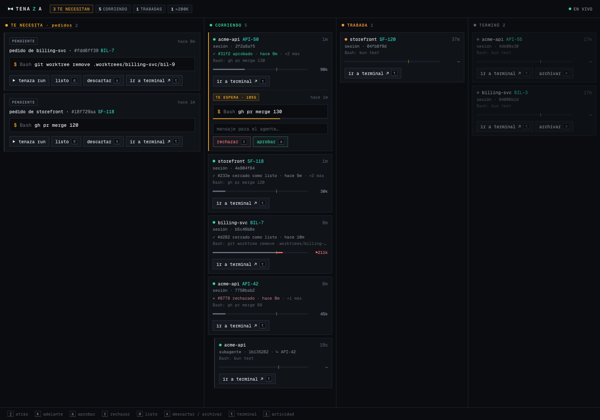
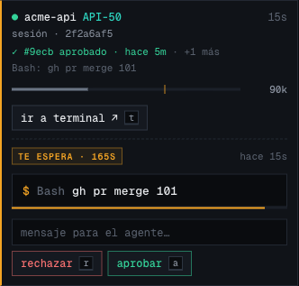
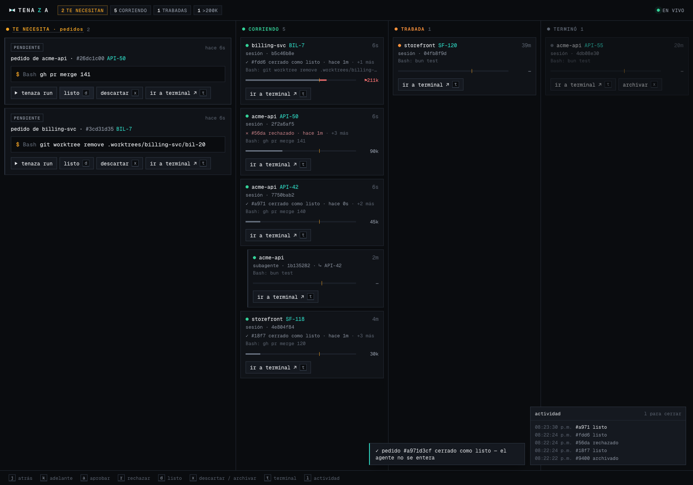

<p align="center">
  <picture>
    <source media="(prefers-color-scheme: dark)" srcset="assets/tenaza-dark.svg">
    
  </picture>
</p>

<h1 align="center">Tenaza</h1>

<p align="center">
  <strong>Hold your coding agents with tongs.</strong><br>
  See every session, keep the risky moves for yourself, and know when a context runs hot.
</p>

<p align="center">
  
  
  
</p>

---

A *tenaza* is a blacksmith's tongs, the tool that holds hot metal so your hands don't have to.
Tenaza plugs into Claude Code's hooks and:

- **Watches** every session and subagent, grouped by project, with a live context bar.
- **Holds** the actions you reserve for yourself, like `gh pr merge`, in an Inbox until you decide.
- **Notifies** you when something waits for you, or when a session crosses its context threshold.
- **Lets you answer live** from a board in your browser, while the agent is still waiting.

It never starts work and never runs a command on its own.

<p align="center">
  
</p>

## What's new in 0.2

- **A live board.** An optional local Daemon serves a board with every session as it happens.
  Approve or reject a held action from the agent's own card, or let it lapse and run it later.
- **Smarter rules.** Rules match the command that actually runs, not text that only mentions it.
  MCP tool calls can be matched too.
- **Fail-safe.** A broken Tenaza never blocks anything new, and it tells you something is wrong.
- **Short ids.** Inbox items use short hashes like `dce9`.
- **Quick access.** `/tenaza` opens the board from any session, and the statusline shows when the
  Daemon is up.

See [CHANGELOG.md](CHANGELOG.md) for the full list.

## Install

Requires macOS and [Claude Code](https://code.claude.com).

```bash
brew tap matiinchauspe/tenaza https://github.com/matiinchauspe/tenaza
brew install matiinchauspe/tenaza/tenaza
tenaza init
```

Use the full name in `brew install`. Homebrew only loads formulae from taps you trust, and the
full name is how you tell it you trust this one. A plain `brew install tenaza` fails with
"Refusing to load formula … from untrusted tap". If you see that error, run
`brew trust --formula matiinchauspe/tenaza/tenaza`.

Then, in Claude Code:

```
/plugin marketplace add matiinchauspe/tenaza
/plugin install tenaza@tenaza
```

`tenaza init` writes a starter Policy to `~/.tenaza/config/policy.toml` and sets up the
statusline. It never overwrites a Policy or a statusline you already have.

### Already have a statusline?

`tenaza init` leaves your own `statusLine` script alone and prints the line to paste in
instead. If your script already reads stdin into `$input` (the common `input=$(cat)` first
line), add this at its end. It prints Tenaza on its own line, so Claude Code's right-side
truncation of an overflowing line never cuts it:

```bash
command -v tenaza >/dev/null && printf '\n%s' "$(echo "$input" | tenaza statusline)"
```

To get the live board, start the Daemon (optional):

```bash
brew services start tenaza   # runs in the background, restarts on login
# or in the foreground:
tenaza ui
```

## Notifications

Tenaza notifies you through macOS's own `osascript` — no extra dependency required to see a
🟡/🔴 banner. Install [`terminal-notifier`](https://github.com/julienXX/terminal-notifier) only
if you want clicking a 🟡 to open the board:

```bash
brew install terminal-notifier
```

It's optional, documented here rather than a `brew install tenaza` dependency — macOS ships
`osascript` with every install, and adding a required Homebrew dependency wouldn't fix the
most common reason a notification goes unseen (below) anyway. Without it, a 🟡 click does
nothing instead of opening the board.

**Never seen a Tenaza notification at all?** Two things to check, in order:

1. **Focus.** A Focus (the crescent-moon icon, Control Center) with no apps allowed mutes
   EVERY app's notifications — Tenaza's included — with no banner and no sound, even though
   macOS still accepts the request. Check **System Settings → Focus** for an active mode, then
   either turn it off or add "Script Editor" to its allowed apps.
2. **Notification permission.** `osascript`'s notifications post under "Script Editor"
   (`com.apple.ScriptEditor2`), never under Tenaza's own name. Check **System Settings →
   Notifications → Script Editor** has "Allow Notifications" on.

## How it works

When an agent runs a reserved command, the hook denies it and tells the agent to wait for you:

> Reserved for the human, inbox dce9. Do not retry or work around it. Tell the user, and continue.

**With the Daemon running,** the agent's card shows the command with **aprobar** (approve, `a`)
and **rechazar** (reject, `r`). Approve, and the agent's call goes through. Reject, and the agent
reads your message. If you don't answer in time, the request moves to your Inbox.

<p align="center">
  
</p>

**Without the Daemon,** the request goes straight to your Inbox. Handle it from the terminal:

```bash
tenaza status          # sessions per project, then the Inbox
tenaza run dce9        # run the held command now
tenaza done dce9       # you ran it yourself
tenaza dismiss dce9    # it no longer applies
```

### The board

The columns are in Spanish: **TE NECESITA** (needs you), **CORRIENDO** (running), **TRABADA**
(stalled) and **TERMINÓ** (finished).

| Key | Action |
| --- | --- |
| `j` / `k` | Move back / forward |
| `a` / `r` | Approve / reject a live request |
| `d` / `x` | Mark done / dismiss a request (`x` also archives a finished session) |
| `t` | Jump to the agent's terminal |
| `l` | Show recent activity |

<p align="center">
  
</p>

`t` focuses the exact tab in Orca and tmux. Terminal.app, iTerm2 and Ghostty ask for macOS
Automation permission first. Other terminals only come to the front.

## The Policy

`~/.tenaza/config/policy.toml` lists the Rules. The first match wins:

```toml
[[rule]]
match = "gh pr merge"
effect = "human"   # hold it for you

[[rule]]
match = "git push --force"
effect = "flag"    # allow it, but record it

[[rule]]
tool = "mcp__*neon*__run_sql*"                 # MCP tool calls
unless = { branch_id = ["br-dev-example"] }
effect = "human"

[flag]
threshold_tokens = 200000
```

The starter Policy holds `gh pr merge` and `git worktree remove`. More examples are in
`policy.example.toml`.

A Policy guards against honest mistakes. It is not a security boundary. A few shell forms are
never matched on purpose: commands run over `ssh`, variable indirection, and scripts written to
a file and run later.

## Commands

| Command | What it does |
| --- | --- |
| `tenaza init` | Set up the Policy and the statusline |
| `tenaza status` | Show sessions and the Inbox |
| `tenaza ui` | Start the Daemon in the foreground |
| `tenaza open` | Open the board (what `/tenaza` runs) |
| `tenaza run / done / dismiss <id>` | Resolve an Inbox item |
| `tenaza label key=value …` | Label the current session, e.g. `ticket=API-42` |

## Upgrade

```bash
brew update
brew upgrade tenaza
```

If you installed from the old `matiinchauspe/tap`, that tap no longer exists. Move to this one:

```bash
brew uninstall tenaza
brew untap matiinchauspe/tap
```

Then follow [Install](#install). Your `~/.tenaza` Policy and Inbox stay as they are.

## Uninstall

```bash
brew services stop tenaza
brew uninstall tenaza
brew untap matiinchauspe/tenaza
rm -rf ~/.tenaza
```

Then, in Claude Code: `/plugin uninstall tenaza@tenaza`.

## Develop

```bash
bun install
bun test
bun run typecheck
```

CI builds the release binaries on every `v*` tag. Design decisions live in [`docs/adr/`](docs/adr/).

## License

[MIT](LICENSE)
